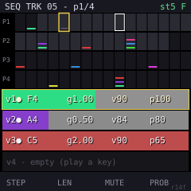
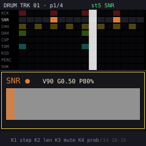

# DriftSeq 屏幕设计 (03)

**日期**: 2026-10-14 · **状态**: rev.10（输入设计并入：**每屏长什么样、怎么操作，以本文件为准**；
02 只留跨屏通用的总原则/硬件不变量/修饰层总表——两文件冲突时以本文件为准）
**前置**: 00（"看见漂移"支柱）、01（模型）、02（总原则；面板事实源：14 按钮 2×6+OCT、
7 encoder 全无 push、27 键 F3–G5、修饰键=GLO 长按——见 02 §1）
**屏幕**: 240×240 彩屏，字库走 melodee 的 ter-u16（16px）/ ter-u12 路线。设计原则照 melodee：
**底部 4 个大字框 = KNOB1–4 当前参数的实时代显**（melodee 的 TUNE/TONE/DECAY/SNAP 4 框即此语法），
屏幕永远能回答"我现在拧的这颗 K 在改什么"。

## 0. 全局帧布局（所有页面共用）

```
┌──────────────────────────────────────────────────┐ y=0
│  TRK 03 │ PTN 05 │ 119 │ U/G/B │ GRID           │  顶栏 16px：
├──────────────────────────────────────────────────┤ y=16
│                                                  │
│                                                  │  主区 200px：
│                                                  │  页面内容（见下）
│                                                  │
├──────────────────────────────────────────────────┤ y=216
│  LOOP LEN 64 │ DIV 1/16 │ ROUTE GM │ CH 010      │  底栏 24px：
│  (K1)        │ (K2)     │ (K3)     │ (K4)       │  K1–K4 大字框 ×4
└──────────────────────────────────────────────────┘ y=240
```

- 顶栏：选中轨号 / pattern 号 / BPM / route 字形（U=USB G=GM B=Both）/ 当前模式（GRID/PLAY）
- 底栏 4 框：固定对应 K1–K4，**显示的是"当前上下文下"这 4 颗 K 绑定的参数**（随页面/选中步切换）——
  这是"手不用看旋钮就知道在改什么"的核心
- 高亮色：选中轨/选中步用 accent（melodee 的 ACCENT 色），其余灰阶

## 1. HOME 总览（GRID 模式主屏）——**"漂移可视化"hero 屏**

16 条横向 loop bar 叠满主区（16×12px=192 + 8px 间隙）：


- **loop 只画一次，从 t=0 起（rev.23，John 2026-10-19）**：每行一条亮带 = 该轨 loop 的一整圈，
  **宽度 = loop_len × division 的真实时长**；亮带右侧到窗口末尾 = **loop 外**，画暗色斜纹床。
  John 原话："不需要铺满hero —— hero 显示 4bar、trk len 8step@1/16 只占 2bar，hero 就应该只显示
  2bar，后面暗色表示 loop 外"。
  - 之前是**平铺重复**填满窗口：每条轨在任何 zoom 下都看起来一样满，而且 loop 的重启点被重复
    图案淹没——**漂移无处可对齐**（重复的图案没有唯一的"这一圈从哪开始"）
  - 现在的读法：亮带宽度 = loop 长度，亮带右缘 = 这一圈用完了窗口的哪里，暗带 = 空转
  - 音符也只画这一圈（不重复），gate 到 loop 边缘截断
- **横轴 = 绝对时间（rev.19，John 拍板 P）**：不是步序号。x = tick，内部时钟 24 PPQ。
  理由：division 是每轨独立的（01 §1），步序号轴隐含"所有轨格长相同"——12 步 @1/8 实际时长是
  12 步 @1/16 的两倍，屏幕上却画一样宽，**相位漂移会显示错误**。而 5 种 division 都整除四分
  （12/8/6/4/3 ticks），所以存在精确公共栅格。
- **zoom（rev.20，John 从头就想要的功能）**：bar 区恒为 192px，zoom 改变窗口覆盖多少小节，
  也就是改变 tick/像素：
  | 档 | 跨度 | px/tick | 1/16 格 | 拍距 | 小节距 |
  |---|---|---|---|---|---|
  | x1 | 96t | 2.0 | 12px | 48px | 192 |
  | x2 | 192t | 1.0 | 6px | 24px | 96 |
  | **x4** | 384t | 0.5 | **3px** | 12px | 48 |
  | x8 | 768t | 0.25 | 1.5px | — | 24 |
  - **x4 是默认档**，1/16 与 rev.18 完全一致（3px 步距 / 2px 块 / 1px 缝），零视觉回归
  - 动机：64 步是上限，但多数轨只有 16 步——x4 下 16 步 @1/16 只占屏 25%，浪费 75%
  - 交互：**GLO + K2**（GLO 是既有的长按修饰键），顶栏右侧直接写**当前跨度**：
    `1 BAR` / `2 BAR` / `4 BAR` / `8 BAR`
    （**rev.25，2026-10-20**：John 实测把 `x2b` 读成 "X2B"——不是他看错，是那个字
    根本不像单位。旧写法 `x4b` 是「梯级标签披了个单位的外衣」：`x` 是旋钮的档位记号，
    `b` 是缩写，两个凑一起谁也不明说「这是几小节」。现在只写跨度和单位本身。
    大写是因为 FONT_T 把小写折叠成大写，`BAR` 是字库的真实输出。代价是字符串变长，
    所以像素探针新增一条：读数最右列必须 < 204，否则会压住 loop-start 的 `S` 读数）
  - **rev.21 修正：zoom 是显示状态，不是页面参数**——GLO+K2 在 HOME / GRID / ARP 三页都生效。
    rev.20 只把它挂在 GRID（`ui_grid_encoder`），而 hero 与 `x4` 读数都在 HOME ——
    唯一能看见效果的那页反而拧不动（实测：HOME 上拧 GLO+K2，小节线仍是 48px；
    必须先切 GRID 拧一下再回 HOME）。同时 ARP 页的成品条硬编码 0.5px/tick（`/2`、`sw*2`），
    注释却自称"与 hero 同一绝对时间轴"，下标 x4 以外的档就与 HOME 对不齐
  - 拍距 < 8px 时（x8）不再画拍线，只留小节线——否则每行变成一把梳子
  - 块宽 = 格宽 − 1px 缝，**下限 1px**；块宽必须跟随 zoom 缩放，否则 x8 下
    2px 块会比 1.5px 的格距还宽、相邻块互相覆盖
- **背景承载双重参照**（John 要求）：
  - ~~loop = 每个 pass 的亮带，交替亮度~~ **作废（rev.23）**：改成"一亮带 + 暗色 loop 外床"，
    见本节第 2 条。交替亮度是为平铺服务的，平铺取消后它只剩下视觉噪声
  - **loop 右缘刻度 = 每轨自己的量具（rev.24）**：2px、轨色满饱和，画在 loop 长度精确位置上。
    **这是每行最亮的东西**——它回答"这一圈到哪结束"，而这是逐轨事实。
  - meter = 小节线 / 拍线，**全局对齐、每行相同**，但**亮度降到 loop 带之下**（rev.24）：
    它只回答"我在小节里的哪里"，不能回答"loop 在哪结束"
  - ~~meter 最亮~~ **作废（rev.24）**：John "如果是12step的trk呢？所以不强调对齐bar，甚至是13step"
    —— 1/16 下 12 步 = 0.75 bar、13 步 = 0.8125 bar，**永远不落在小节线上**；把小节线画成
    全行最亮等于宣称"loop 用 bar 计量"，恰好否定了 polymeter 本身
  - ~~1px 接缝~~ 已弃：loop 重启点必然是 step 0，而 step 0 通常有音符，接缝会被音符块盖住；
    交替亮度不会与任何元素冲突，且任意 pass 宽度下都可读
- **melody 行的纵向 = 音高轴（rev.27）**：行内 11px 用作 pmin..pmax 映射，高音在上，
  与 GRID melodic 页同一套 `pmin/pmax` 扫描与取整，所以同一个音在两屏的相对高度一致。
  1px 线宽，颜色 = hue12(note)；**线长 = gate**，所以长音就是一条长线、断奏是一个点。
  `gate=0xFF`（到下一个音/loop 末）在绘制时解析，编辑后即时反映。
  - ~~4 条固定 voice 槽位（v1–v4，`(sort_n-1-vi)*3`）~~ **作废（rev.27，2026-10-20）**：
    John "melody trk 还没有修复"。槽位序号是"这一步有几个音"的事实，**不是音高**——
    demo trk5 跨 C5/E5/G5/C6 三个八度，四个音全画在 dy=1 这一条线上，整行不含任何
    旋律信息。位置和 gate 本来是对的，错的是纵向编码。
  - 像素探针新增两条：C5<E5<G5 与 C2<D#2<G2 必须逐级升高（dy 递减）
- 鼓行保留 9-lane 乐器小横线。
- **每轨一条自己的 playhead（rev.23，John 2026-10-19）**：John 原话"这样每个trk都有自己的
  playhead，可以表现出drift"。
  - 弃用全局单线：全局线只能说明"共享时钟走到哪"，而 polymetric 漂移是**每轨各自的事实**——
    每条 loop 在自己的长度上回卷
  - 位置 = **该轨的绝对 step 槽位** + 亚格小数（`pos16` + `frac16`，与引擎调度同一个时钟），
    所以线不会对音频撒谎

  **rev.26（2026-10-20）：hero 的时间轴是绝对 step 槽位，不是播放顺序。**
  John: "hero drum trk 显示有问题，例如trk2，能看到第二拍有四个横线……但实际上第一拍第三拍有音符" ／
  "都是hero画面有问题，grid画面正常"。GRID 画 `steps[page*16+c]`（绝对下标），hero 却把
  窗口内的第 s 步画在 `tx(s*ct)`（播放顺序），于是 `loop_start=4` 的 trk2 在两个视图里
  整整错开 4 格——hero 上表现为"前 4 格空、音符挤在中间"。demo 数据是绝对 4/7/9/12/14，
  hero 现在逐格与之一致。
  - loop 窗口 = `[loop_start, +loop_len)`，亮带**从 loop_start 起**画，两侧都可能是暗区
  - 这正是 §1.1 早就写的 "K1 拧动时**亮带整体平移**、音符不动"——只有绝对坐标轴才成立；
    旧的播放顺序实现里，改 loop_start 反而是音符在动、亮带不动，与规格相反
  - playhead 同样改为绝对槽位（`pos16` 本身就是绝对下标，不需要再减 `loop_start`）
  - 像素探针新增断言：trk1/trk2/trk3 的音符位置必须等于 pattern 的绝对槽位
  - 行的时间映射各归各（自己的 division、自己的 loop 带），于是**漂移 = 各行的头相对自己的
    loop 带推进速度不同，且彼此错开**；小节线只提供"现在离小节起点多远"的公共参照
  - ~~"漂移读作各行跨过同一条小节线"~~ **修正（rev.24）**：12/13 步的 loop 根本不跨小节线，
    这个说法只在 loop 长度是 bar 的整数倍时成立——而那不是常见情形，更不是设计前提
  - 无头 = 该轨当前相位在 loop 外（理论上不会，引擎会在 loop 外 snap 回 start）
- 顶栏增加当前轨 division（`TRK 4-PTN 01-120-1/16`），右键右侧仍为 `S nn`。
- `▌` = playhead；**不同轨的音相对小节线滑动 = 相位漂移，直接看见**（支柱 2 的落地）
- 左端：轨号(2位) + loop_len(2位) + route 字形（**A**=all **B**=ble **U**=usb）；行可点选（SELECT 循环 / 黑键区点击）
- 选中行高亮；mute 的轨变暗 + 加 `M`
- **这屏不画 step 编辑**，只画相位与音长——它是"全局状态"，不是"编辑工具"
- 顶栏不放模式字（GRID/PLAY），屏内容本身自明；顶栏 = `TRK nn │ PTN nn │ BPM`，右侧角标 = 选中轨
  loop_start 读出 `S nn`（绿色）——K3 拧动时亮带在动，角标给数字锚点（"确切位置"）
- **纵向预算恰满**：20px 顶栏 + 16×12px 行 + 20px 底栏 = 240px；HOME 不设额外读出行
  （曾试过 S/L 独立行，16 号轨被挤出屏，废）——LEN 已在每行行首，不重复显示选中轨 LEN

### 1.1 HOME 页底栏 K1–K4（每屏绑定不同；此页 = 选中轨的漂移/演奏参数）

| 框 | 参数 | 动作 |
|---|---|---|
| K1 | `LOOP START` | 拧动即时改选中轨 loop_start（亮带整体平移，hero 屏直接可见；顶栏 S 角标实时跳） |
| K2 | `LOOP LEN` | 拧动即时改选中轨 loop_len（live morph：窗口收缩越过的已触发音 gate 走完不硬切；行首 LEN 实时反映）；**GLO+K2 = zoom**（rev.21，本页生效） |
| K3 | `MUTE` | 拧动切换选中轨 mute（行首加 `M`、bar 变暗、顶栏 S 角标变暗） |
| K4 | `PROB` | 选中轨 cursor 步的 prob（±5%/格）。**cursor 在 HOME 屏不可见**（hero 不画 cursor——
  它是相位总览屏）；拧动反馈 = 该步块透明度变化（prob<100 的 on 格 55% 显）+ GRID 页黄框可核位。
  precision 编辑去 GRID/EDIT 页做，HOME 的 PROB 是"顺手带一手"定位 |

- SELECT 换轨 → 4 框立即跟随新选中轨的值；PLAY 中拧 K1/K2 = "现场拖亮带"（00 §支柱2）
- **SELECT 不循环**：拧到 16 即停（未来加加速——快拧直接跳 TRK01/TRK16，便于盲操；
  先按物理行程自然端点实现）
- 这 4 框是 HOME 页的**唯一** K 语义；SEQ/EDIT/ARP/GLO/PLAY 各页另有绑定（§7 路由表逐页列出）
- emu 已按本表实现；§7 旧表 HOME 行"len/div/route/ch"作废、已同步为本表

## 2. MELODY GRID（melodic 轨专用；drum 轨整屏切 §3，两视图无共享组件）

主区 = **64 步全览（16×4）**，行 = 页（历史布局：键床 16 白键一页 → 4 行；**OCT± 已不再
翻页**——rev.7 步录入常态化后 OCT± = 键床音程移位（§2.3），行只是 64 步的分行画法）：



- **纵向预算恰满（rev.12）**：16 顶栏 + 4×24 网格 + 4×26 voice 面板 + 24 底栏 = 240px
- **EDIT 键 = 焦点切换，不换页**（rev.12 John 纠正）：EDIT 面板**常驻** GRID 下半部；
  EDIT 键 toggle 的是"K1–K4/SELECT 作用层"——GRID 层（step/mute/prob）↔ EDIT 层
  （voice 卡 PIT/GAT/VEL/PRB），屏上用**活动卡黄描边 + 底栏 K 标注**表达当前层
  （drum 轨的下半面板显示该步鼓音行，§3.1）

### 2.0 步录入 = 常态，无进出（rev.5；rev.11 = 覆盖制）

GRID 主页永远处于 step-entry 语义：cursor 常驻、弹键即写、K1 即移动——无"模式进出"
（~~ENV+LFO 同按进出~~作废）；实时录音 = REC 键 arm，与步录入并行不悖：

- **弹键 = 定义 cursor 步的内容并试听**（rev.11 **覆盖制**，John：同位置的录入动作应该是
  覆盖）：单键 = 该步 := {该音}；同时按多键（≤4）= 该步 := {和弦}——**一次按键即该步的
  全部内容**，已有内容的步再弹 = 整体改写（不是追加）；rest 步弹键 = 改写并复活（en=1）。
  一次按 >4 键 = 拒绝（LED 闪）
- 全部松开后 cursor 自动前进一格（QY 行为；st64 处停住不回绕）
- **写入的确认通道 = 白键 LED**：覆盖制是"整步改写"，眼睛不必每次回屏确认——该步有没有内容
  由键床自己回答（§3.2）。这是 §3.2 那条 dim/亮语法在 melodic 侧存在的理由
- **黑键**：键床音域内 = 键盘黑键（升降号，弹键写入含黑键音）；GLO 长按+黑键 = 第二层修饰排（02 §1）
- **loop 窗口手势（rev.11 定稿）**：**GLO+K1 = START、K2 = LEN**——64 步全程可达；
  ~~GLO+单击两点~~**作废**（取点只能在当前页 16 步内，跨页窗口设不了，John：鸡肋；×16 快进
  同批让位，见 §2.3）。屏上反馈不变：窗口外 dim、起点实竖标、本体亮带
- **live 窗口变形**：拧 K2 改 len 即时生效（全 notes-safe——窗口收缩越过的已响音走完各自
  gate，不发 note-off 断奏）；engine 侧 = 纯参数读，天然确定性
- **回改工作流（rev.11，OCT 键簇上完成——GLO+OCT−/OCT+ 物理相邻）**：修改 = **GLO+OCT−**
  （回退一格）→ 重弹（覆盖制改写）；清除 = **GLO+OCT−** → **GLO+OCT+**（rest，en=0 静默
  可复活）；跳过空步 = K1 右旋（空格无标记）。~~同音重按 = 删除~~随覆盖制作废——GRID 删音
  = rest（ voices 保留）；要真删 voice 用同音重弹（EDIT 层，§2.4）

### 2.1 单格语义（~14×24px，melodic 轨）——rev.11 渲染改版 + rev.12 压缩

```
┌──────┐   格背景 = 中性底，**亮度编码 loop 范围**：窗口内亮 / 窗口外暗
│  ──  │   note = **横线**，每 voice 一条（≤4），线色 = 该 voice 音高的色相
│  ──  │   （12 半音 × 30° 色环）；**按音高排序，高音在上**——不再用 v0 填充整格
│  ──  │   playhead 步 → 白描边；cursor 步 → 黄描边
├──────┤
│▁▁▁▁▁▁│
└──────┘
```

- **为什么改**（John rev.11）：整格填充只读得出 v0，v1–3 挤在格底 3px 色条不可读；横线化后
  4 个 voice 一视同仁；背景亮度让 **loop 窗口即使空步也可见**（铺骨架时窗口形状一眼可读）
- 空 loop 内步 = 亮背景无线；空 loop 外步 = 暗背景无线
- **线的纵位 = 固定槽位（排序位）而非音高映射**：~~45px~~ 24px 塞不下 12+ 半音的可靠 y
  映射（相邻半音 <2px 不可分辨）——纵位编码不可靠，音高信息由线色承载
  （反冗余：同一信息只编码一次）
- **rev.12 bar 压缩 45→24px**（John：槽位制下高度不承载音高信息，45px 是浪费——砍到
  24px = 4 voice 槽各 6px，省出 84px 正好放 **EDIT 面板嵌页**）：网格+细编同屏，
  改一个音不用进页，改完立刻在网格里看见新横线
- rest 步（en=0，voices 保留）：线画成**空心/虚线**——内容还在但不响，与「清空」可区分

> 鼓轨不走本节：ch10 轨整屏切 §3 lanes 视图——色相=音高的语义对鼓无意义，
> 鼓色定义（乐器身份色）收编在 §3。

- **已知局限（John 拍板：留待 real-time record 一并解决）**：~~和弦挤 3px 色条~~已解
  （rev.11 横线化，4 voice 各占一线）；~~剩时值/gate~~已解（rev.19：hero 线长 = gate；
  gate 语义接入引擎，sequenced note 现在真的发 note-off）
- **精确音名**不给格子塞字（14px 塞不下也不可读）：选中/cursor 步的音名上**顶栏角标**
  （`st18 C3`，与 HOME `S nn` 同语法），完整细节在 EDIT 面板（§2.4，同屏下半）
- prob<100 的 on 格：底部已有暗条（v1 emu 语法保留）

### 2.2 底栏 K1–K4（MELODY GRID）

| 上下文 | K1 | K2 | K3 | K4 |
|---|---|---|---|---|
| 常驻（轨级） | `cursor 移动`（±1，死停） | `LOOP LEN` | `MUTE` | `PROB`（±5%/格） |
| GLO 长按 | `LOOP START`（rev.11） | `hero zoom`（rev.20） | **`DIV`**（rev.22） | — |
| EDIT 层（下半面板，§2.4） | `PITCH` | `GATE` | `VEL` | `PROB` |

- rev.11：**GLO+K1 = LOOP START**（John：这样 GRID 页就能方便地改 loop 的开始和长短——
  K2 直接拧 = LEN、GLO+K1 拧 = START，窗口形状两颗旋钮全覆盖）；无修饰的 K1 仍是 cursor 轴
  （§2.3，最高频动作占裸旋钮）
- ~~rev.9"窗口起点只留 HOME 页 K1"~~作废（rev.11 GLO+K1 把 START 拉回 GRID）
- ROUTE 不占 GRID 底栏——route 批量编辑在 GLO 矩阵（§5），单轨 route 也在 GLO
- **rev.22：GLO+K3 = DIV**（John 2026-10-19："DIV现在没有设定的方法，在grid screen设置比较好"）。
  division 是**轨级**步长（01 §1），所以入口放在画着步的页面；HOME 顶栏只**显示**它。
  五档 `1/8 · 1/8T · 1/16 · 1/16T · 1/32`（`DS_DIV_*`），两端死停——盲拧时循环会让用户
  在 1/32 继续拧一下跳回 1/8 而毫无察觉，端点停死是可预期的。
  顶栏 DIV 读数在 melodic 与 drum 两种 GRID 都出现（值改了却看不见 = 没有控件）。
- **rev.22 同时修掉一处自相矛盾**：旧代码 `GLO+K1 = cursor ×16`，而 rev.11 已把 GLO+K1
  让给 LOOP START（本节上一行）。现按 rev.11：GLO+K1 = START，裸 K1 = ±1 步进

### 2.3 手势总表——cursor 移动 + 步编辑（melodic；drum 见 §3.1）

**melodic 轨**（键床 = 纯音高键；cursor 移动全在旋钮——rev.5 John：白键点选跳格作废，
STEP-ENTRY 无进出、是常态）：

- **白键 LED 语法**：长亮 = 该键对应步（cursor 所在 16 格页内映射）on，熄 = off——键床是
  "本页 16 步的实体化"，铺骨架可全程不看屏；屏负责全 64 步与参数细编。**完整语法（dim 拍线、
  key id 寻址、静音行为）见 §3.2**，与鼓轨共用同一套实现，只有"什么算 on"不同。
  rev.29 起补上 dim 拍线；rev.30 起修正为按 key id 寻址（此前按白键序号，点亮的物理键全错）。
  ⚠️ **§3.2 记的 playhead 闪烁尚未实现**——本节旧文曾把"闪 = playhead"当既成事实，实为缺口。

| 手势 | 动作 |
|---|---|
| **K1 左旋 / 右旋** | cursor 后退 / 前进一格——**纯 cursor 轴**，主移动手段 |
| 弹键（白/黑键） | **覆盖** cursor 步内容（§2.0：单键=单音，多键≤4=和弦），试听 |
| **GLO 长按+OCT−** | **回退一格**（rev.11 John：回退放 K1 没问题，但 GLO+OCT− 更顺手——OCT 键簇紧邻键床左手区，"回改 = 回退→重弹/rest"整条动线在物理上连成一团） |
| **GLO 长按+OCT+** | **rest/tie/复原 三态循环**（rev.11 回迁 GRID：清除上一步 = 回退→rest 一步到位，不用进 EDIT 层；EDIT 层 GLO+K4 同功能保留——两处入口同语义） |
| **OCT−/OCT+（裸按）** | **键床音程移位 ±12**（rev.7：弹键音域只有 F3–G5，OCT± 必须留给移位；顶栏角标 `+12`，松开归零，可叠到 ±24） |
| ~~GLO 长按+K1~~ | ~~×16 快进~~**作废**（rev.11：GLO+K1 让位给 LOOP START，§2.2；跨页定位走 K1 连拧） |
| EDIT 层 OCT−/OCT+ | cursor 后退/前进一格（EDIT 层键床不弹奏，无移位冲突） |

- **OCT 键簇语义总表（rev.11）**：裸按 = 键床移位（弹奏轴）/ GLO+按 = 步编辑轴
  （回退 / rest-tie）——同一对键，修饰层切换"弹奏↔编辑"两个世界，物理相邻，盲操零学习

> rev.5 记录：白键点选跳格曾是 melodic 的选择手段，其卖点"盲操"在步录入常态下无意义
> （弹键写步本来就在 step-entry 语义里，眼睛早就在屏上了）——作废，cursor 移动全归 K1。
> 白键点选若将来复活，只在"屏上点格"不可用的场合（无触屏真机 + 屏幕坏了）作为恢复路径。

### 2.4 EDIT 面板（GRID 下半部嵌页；rev.14 emu 实态）

对象 = cursor 所指步（常驻，永不空）。面板 = 该步的 **4 张 voice 卡**（4×25px）：

- **每卡 = 整行参数条**（rev.14c John：单独小条太费眼）：整行背景 = 灰底（亮度 = vel）
  + 音高色相 bar 从左延伸（长度 = gate，8 步满刻度；`∞` = 满格 + 右端闪点）+ 灰化度 = prob
  （100% 纯色相 → 0% 全灰；不换色相——色相已表音高）；文字叠在条上（11px，深色 1px 投影保读）
- **文字 = 精确值，固定列对齐**（rev.14d John：音名长短不齐会挤歪后列）：
  `v1● F4  g1.00  v90  p100`——音名 pad 3 字符（C3/C#3），g/v/p 各锚定固定 x 列
- **活动卡黄描边** = 焦点在 EDIT 层的可见信号（连同底栏标注切换）；**EDIT 键 toggle 焦点层，
  不换页**（rev.12）
- **EDIT 层弹键不前进 cursor**（rev.14a John：EDIT 里黑白键都是改当前 voice，不该跳步）——
  GRID 层弹键才走覆盖制 + 前进（§2.0）
- **输入（rev.11/14a）**：任意键 = 按键音高占空槽并激活（新 voice 成为活动卡）；
  **同音重弹 = 删除该 voice（任何卡，不限于活动卡）**
- **满槽写入（4/4 弹第 5 音）**：**替换当前最高音**（remove+add）——屏显按音高升序，
  低音 = bass 优先存活（v1 > v4 槽位优先级 rev.11 定稿的落地：认音高不认槽位，与屏显一致）
- **voice 排列 = 音高升序**（高音在上，与 GRID 横线同序）；手工 K1 改音高就地保留位
  （不重排，防跳位打断定位感）；外来变更（GRID 重弹覆盖）才归位重排
- **EDIT 层 K 绑定**（底栏切为 `PIT GAT VEL PROB SEL`，无 K 前缀）：
  - **K1 = PIT**（活动 voice ±半音，0..127 端点死停；GLO 长按+K1 = cond 枚举 + 大字反馈）
  - **K2 = GAT**（×0.25 步，0.25..8.00，8.00 再 +1 = `∞`；`∞` 再 +1 回 0.25）
  - **K3 = VEL**（1..127）
  - **K4 = PROB**（0..100%，步级——prob 属 step 不属 voice，01 §2）
  - **SELECT = 切活动卡**（v1↔v4 端点死停）
- **删除 voice 两条路**（rev.11a John 砍 GLO+K2 新手势）：**同音重弹真删**（最快）/
  **rest 化 = GLO+OCT+**（en=0 静默保留可逆，GRID 屏显灰虚线；EDIT 层 GLO+K4 同义别名）
- title 和弦名：maj/m/m7/maj7/dim/aug/sus2/sus4 可识别，其余列音名列表（st1 起）
- GATE 单位 = 本轨 division 步（01 §2），屏显换算小数；`0xFF = until next event` 显 `∞`

### §2.1 design note：为什么不是 piano roll（10-16 讨论，10-17 收口：**选 B**）

John 问：melodic grid 为何不用 piano roll？当时 rev.11 选型的真实分叉，摊开存档：

**Roll 的优点（现方案缺）**：旋律轮廓一眼可读（现方案音高=颜色+上下序，轮廓基本不可读，
进 EDIT 才见 PIT 值）；gate=条宽（现恒满宽）；和弦 voicing 相对位置可见；通用语汇零学习。

**现方案的优点（本机大概率决定性）**：
- **导航 1D**：SELECT 单光标走 64 步、OCT 键床弹音高，盲操成立。
- **全 64 步一屏**：loop 窗口/Euclid 重铺后整体形状/HOME 相位对照全靠全景
- **语言一致**：HOME/drum/melodic 全是"行×步"，SELECT 语义全局统一

**10-17 复核（John 两连击修正）**：
- "roll 不必表现全音域"——27 半音反对作废（自适应音域后行高够读）
- **Polly 反例**（fm1-polly，同 FM-1 硬件 QY70 风格 arranger，Felucca 平台层）Notes 页：
  SELECT=扁平音符遍历（时间序、和弦内低音优先 lowest first）——**"roll 必须 2D 光标"
  作废**。其 K1–K4 直拧音符四属性（Place/Pitch/Length/Velocity），zoom 挂 PRESETS
  （8/4/2/1 bar），全屏 roll 无嵌面板。细节见 MANUAL "The Notes page"
- 仍存的真差异：EDIT 嵌卡（rev.12 地基，Polly 无对应物）vs 全屏 roll；页面语言一致性

**拍板（10-17）：B = 线位=音高（现状改进），roll 方案 C 挂起待仔细评估**——
voice 线在格内纵向位置 = 本轨 voice min..max 归一化（空轨兜底 C3–C5 居中），
重叠=音程小（信息，不消除）；线宽=gate（#17）另批。contour 实测：
demo bass 48/51/55 三线 y=34/28/21 单调上行 ✓（emu r16b）。
C（Polly 式局部 roll，GLO 切换+扁平遍历+K 直拧属性）留档 v1.1 评估。

## 3. DRUM GRID（ch10 专用 lanes 视图，覆盖 §2；键床 = 808 面板心智）



- **纵向预算（rev.13b，rev.22 落实）**：16 顶栏 + 9×11 lanes(99) + 100px 单鼓卡 + 24 底栏
  ≈ 239px ✓（melodic 4 行×24=96 vs drum 9 lanes×11=99——两轨型主区等高，
  底栏/顶栏完全共享；lane 11px = 7px 格 + 4px 缝，按压力度足够触屏点选）
- **rev.22（John 2026-10-19 拍板）**：lane 数 = **9**，就此关闭 §8-11 的 9/11 之争。
  此前固件画的是 11 lane × 13px（跟 emu 走），与本节的 9×11 自相矛盾——现在代码回到本节。
  多出的 2 颗黑键仍然保留（§3 下行），但不再对应 lane。

- **所有鼓同屏**（编辑决定，John：对齐鼓点要看相对位置）vs 只显当前选鼓（拒绝——多鼓对齐
  全靠脑补）；当前选鼓 lane 高亮 + 顶栏角标 3 字符缩写
- lanes 数 = **9**（= `NDRUM` = 鼓键表长度）；64 步全宽（页边界淡分隔线，白键 LED 映射页随
  cursor 所在 16 格走，屏不动）。`NDRUM` 是唯一真相：表、lanes、键选、调色板取模全走它，
  加 lane 只改这一个宏
- **黑键 11 颗 > 常用鼓音 9**：末 2 黑键预留（v1.1 percussion/拍手扩展），选不满不报错——
  rev.22 起按键直接按 `NDRUM` 判界：超出范围的黑键**不改选鼓**（保持当前选鼓），不报错也不
  回绕到 KCK
- **白键 LED 语法**：见 §3.2（rev.30 起为权威定义，本条原先散落在此）
- **on 格色 = 乐器身份**（鼓的 pitch 无意义，不能用色相=音高）：同一 note 恒同色——
  kick 红 / snare 橙 / CH 黄 / tom 绿 / ride 青 / clap 粉…；索引走鼓键表（GM_DRUMS
  下标）而非裸音高，GM 槽位重排时颜色跟着乐器走
- 白键 LED 与屏分工：键只反映**当前选鼓**（硬件约束），屏负责**全局相对位置**——这是
  "键床可编辑"与"屏可对齐"的最优分工

### 3.1 鼓轨手势（808 心智；与 melodic §2.3 完全分开，不互换）

**drum 轨**（键床 = 鼓机面板：黑键选鼓、白键 toggle 该鼓发音位）：

| 手势 | 动作 |
|---|---|
| 黑键 | **选鼓**（drumSel；白键 toggle 的对象跟着变）——不移动 cursor |
| 白键 | toggle 当前选鼓在该格的 on/off——**编辑动作，不是选择** |
| **屏上点 lane 格**（emu/真机触屏） | cursor 跳到该格（触屏是鼓轨唯一"跳步"手势） |
| EDIT 层 OCT−/OCT+ | cursor 后退/前进一格（同 melodic） |
| EDIT 层内白键 | 试听当前选鼓（不入 voice——写入只发生在 GRID toggle） |
- 分开的理由：melodic 键床 = **纯音高**（移动/写入由旋钮+弹键分工，钢琴心智），drum 键床 =
  **乐器选择+开关**（808 心智）——两套肌肉记忆都成立，但**不互换**；cursor 在 drum 轨退居
  "EDIT 细编的定位器"，GRID 日常编辑（铺/删鼓点）完全绕开它
- EDIT 层对 drum 轨 = 当前选鼓的**单卡**（rev.13c），K1 COND/K4 PROB 同语义；
  K2 GATE/K3 VEL 作用于该卡（= 当前选鼓）
- **drum 轨 EDIT 面板 = 单鼓卡，不是多鼓列表**（rev.13c，John："'同时编辑一个 step 的不同鼓'
  是很罕见的需求"——拍板）：面板**只显示当前选鼓（drumSel）在 cursor 步的那 1 张卡**；
  换鼓改另一步的参数 = 黑键换选即可，无需多卡并存。lanes 全景（§3 上部）本来就承担
  "这一步敲了哪几件"的展示（亮格纵览），面板不必重复
- **下部面板因此更宽敞**：单卡占满 4 行高度中的一行、其余 3 行显示同 lane 相邻信息？
  ——否，**单卡放大为整块**（25→100px 大卡：大字号 vel/gate/prob + 参数条三编码全部展开，
  数字+图形双通道满配）；罕见的"同 step 双鼓细编"场景 = 黑键换选两次，各进各的卡
- drum 卡 = 3 字符鼓缩写（KCK/SNR…）+ 乐器身份色；参数条渲染同 melodic（背景亮度=vel、
  bar 长度=gate、灰化=prob——鼓音色相固定，只动明度/饱和度）（melodic 卡整行=参数条同构，§2.4）
- **drum 大卡 K 绑定 = 同 melodic EDIT 层**（§2.4）：K1 PIT/K2 GAT/K3 VEL/K4 PROB、
  SELECT = 黑键职责已占用选鼓（SELECT 拧仍切活动卡——单卡无第 2 张，退化为无操作）；
  GLO+K1 = cond、GLO+K4 = rest/tie 别名，均同 §2.4
- **drum 大卡弹键**（EDIT 层）：黑键 = 换选（audition）；白键 = 试听当前选鼓（不入 voice——
  写入只发生在 GRID toggle，§3.1 手势表）

### 3.2 键床 LED 语法（rev.30；drum 与 melodic 共用一套，判定对象不同）

> 起源：John 2026-10-20 两轮反馈——"drum grid中，选中的鼓，对应的鼓点没有点亮白键。
> 理想情况下可以用dim表示1，5，9，13，亮起白键表示这个step有鼓点"；随后"亮，但是亮的不对
> （估计是没考虑到黑键，没有跳过黑键）应该是选择某个黑键，那么这个黑键亮起，对应鼓点的白键
> 亮起"。

**键床几何（一切 LED 寻址的前提）**

键床是**原生钢琴**，不是 16 个抽象按钮。27 个键 id 0..26 = 音高 53..79（F3..G5），其中
白键 16 颗、黑键 11 颗：

```
id:  0  1  2  3  4  5  6  7  8  9 10 11 12 13 14 15 16 17 18 19 20 21 22 23 24 25 26
key: F3 F#3 G3 G#3 A3 A#3 B3 C4 C#4 D4 D#4 E4 F4 F#4 G4 G#4 A4 A#4 B4 C5 C#5 D5 D#5 E5 F5 F#5 G5
step: 1     2     3     4     5     6     7     8     9    10    11    12    13    14    15    16
drum:   KCK  SNR  CHH  OHH  CUP  TOM  RID  PERC  SHK   (reserved)   (reserved)
```

- **白键序号 ≠ 键 id**：16 个步进白键的 id 是 `0,2,4,6,7,9,11,12,14,16,18,19,21,23,24,26`。
  LED 掩码按 **key id** 寻址（`panel.js` 的 `keys[]` 按 id 索引；FM-1 HAL 的 note key i =
  id `14+i`），不是按白键序号。rev.29 首版按序号位移，点亮的物理键全错——越往右偏差越大，
  整个右半键床在描述错误的步。反查表：`key_white_id(ord)` / `key_black_id(ord)`。
- **黑键 ordinal ≠ 键 id** 同理：drum 0..8 → id `1,3,5,8,10,12,15,17,20`（F#3..A#5）。

**三态语义**

| 状态 | 白键 | 黑键 |
|---|---|---|
| **亮（lit）** | 当前选鼓在**该步**有鼓点（melodic 轨：该步有 voice） | 这颗黑键**就是当前选鼓** |
| **暗（dim）** | 该步是**拍线**（1/5/9/13 @1/16） | — |
| **熄** | 其余 | 其余 |

- **拍线按 tick 算，不是"每 4 步"**：一拍 = `TPB/4` = 24 tick。硬编码每 4 步会在五档里的
  三档上把拍线放错位置，比没有拍线更糟——因为它看起来是权威的。实测五档：
  `1/8 → 1,3,5,7,9,11,13,15` · `1/8T → 1,4,7,10,13,16` · `1/16 → 1,5,9,13` ·
  `1/16T → 1,7,13` · `1/32 → 1,9`
- **亮优先**：拍线与鼓点落在同一步时点亮（听得见的事实压过参考线）
- **选中鼓的黑键必须亮**：白键只说"这一步有鼓点"，从不说"是哪个鼓"——这是键床上唯一无法
  从白键本身推断的信息，必须由你按下的那颗黑键给出。没这条时，面板不反馈"白键现在描述谁"
- **轨静音**：亮全灭（含黑键），**拍线保留**——盲铺时更需要参考
- **页随 cursor**：一颗白键 = **cursor 所在 16 格页内**的一步；翻页时屏不动，键床换页

**实现拓扑（为什么两端必须共用一份）**

`firmware/src/ui.c` 的 `ui_leds()` 是**纯函数**（输入 = UI 编辑状态，无时钟），两个前端读
同一个掩码：

- web：`ds_ui_frame()` → 导出 `ds_web_lit_k/dim_k/lit_b/dim_b` → `panel.js` 的 `drawLeds()`
- 真机：`ui_leds_sync()` → HAL `fm1_led_key()` / `fm1_led_key_dim()`（dim 平面靠
  `fm1_led_dim[]` + `fm1_led_dim_div`，不额外占扫描时间）

rev.29 之前这条链**整条是空的**：`leds.c` 只保存 MIDI-in 的被动镜像（`midi_io.c` →
`leds_on_note`，用于 host 驱动面板），固件里没有任何代码把 UI 状态写给 LED，所以白键显示
的是"上一条 MIDI 消息说过的音"——通常什么都没有。

**未完项（明示，不隐含）**

- **playhead 闪烁未实现**。`ui_leds()` 刻意不含时钟（否则不可断言）；闪烁须由持有帧时钟的
  前端叠上，键位取 `g.pos16[sel_track]`。本条此前在 §2.3/§3 被写成既成事实，实为缺口。

## 4. ARP / Euclid 页（生成器页；v1 = Euclid，ARP 半区 v1.1 占位）

**对象 = 选中轨**（SELECT 换轨，全局共享，进页不换对象）。进入 = `ARP` 键；离开 = `SEQ`/`HOME`。
（下节布局图为语义示意——大屏 SVG mockup 待 emu 实装后按实态生成，同 03 惯例）

### 4.0 布局（纵向预算恰满 240px）

```
┌──────────────────────────────────────┐ y0
│ ARP TRK 03                 ● LINK    │ 顶栏 16px：●LINK(绿, eu_on=1) / FREE(灰, 0)
├──────────────────────────────────────┤ y16
│ ▁▁▁ 64 步成品条（hero 行语法）▁▁▁▁▁ │ 12px：窗口亮带 + on 块轨色 + playhead 白刻
├──────────────────────────────────────┤ y28
│            · · • · ·                 │
│         •         •                  │ 圆环区 y28..196：Ø160，圆心 (120,112)
│        ·  E(16,4) ·                  │ n 刻度点均分圆周（顺时针=时间前进，
│        ·         ·                  │ 正上方 = pattern 第 1 格）；k 个脉冲点
│         ·         ·                  │ = 轨色亮点；playhead = 白刻度
│            · · · ·                   │
│   K 4    N 16    ROT 0     ARP v1.1  │ 数字行 y196..216（16px，固定列）
├──────────────────────────────────────┤ y216
│  K        N        ROT     LINK      │ 底栏（无 K 前缀 10px 固定列）
└──────────────────────────────────────┘ y240
```

- 16 + 12 + 168 + 20 + 24 = 240 ✓（圆环 Ø160 上下各留 4px；n≤64 → 5.6°/点，r=80 处弧距
  ~8px，可分辨）
- **成品条跟随 zoom（rev.21）**：条与 hero 同一 `tx()` 换算，档位一变条也跟着变；
  顶栏同时给 `N BAR` 读数（与 HOME 同语法）——因为它俩就是同一条时间轴的两个视图，
  读数只在 HOME 出现会让 ARP 页的条变成没有刻度的尺子
- **64 步成品条** = hero 行画法复用（窗口亮带、on 块轨色、drum 轨横线堆叠、playhead）——
  生成结果落在 loop 里的真实样子，K1–K3 拧动实时刷新；它与圆环分工：条 = loop 语境，
  圆 = pattern 本形（两条信息不重复：一个是"什么时候响"，一个是"节奏型长什么样"）
- 圆环上 **loop_start 不标**（pattern 相位与 loop 窗口解耦，窗口信息在成品条）；
  ~~脉冲连线多边形~~不要（装饰性，反冗余）
- n>32 时刻度点缩为 2px 点（可分辨下限），脉冲点恒 4px

### 4.1 K 绑定与语义

| 框 | 参数 | 动作 |
|---|---|---|
| K1 | `K` | 脉冲数 1..N（N 缩小时 clamp 到 N）；拧动即重铺 |
| K2 | `N` | 步数 2..64；拧动即重铺；**GLO+K2 = zoom**（rev.21，成品条与本页读数跟随） |
| K3 | `ROT` | 旋转 0..N-1，**端点死停**（0..N-1 已覆盖全部旋转，死停不丢信息）；拧动即重铺 |
| K4 | `LINK` | 右拧 = eu_on=1 + 按当前 meta 重铺；左拧 = eu_on=0（steps 冻结，meta 保留可回） |

- **重铺规则（幂等，唯一写法）**：只写 en 位——`steps[i].on = pat[(rel − rot) mod n]`
  （rel = (i − loop_start) mod 64；窗口外 en=0）；**voices/vel/gate/prob 永不动**。
  唯一例外：on 步若整步无 voice → 铺默认 voice，**仅 drum 轨**（= 当前选鼓 note，
  vel 100 / gate 1）；**melodic 轨不种默认音（#13 拍板 10-16）**——已写和弦的旋律轨
  fill 只改门（半数和弦哑掉但不搬家、不冒 C3 孤子），真空轨铺完静默可接受（步骤灯仍
  亮，进 GRID 补音即可）；铺两次 == 铺一次
- **手改与重铺（覆盖制，无 detach 状态）**：GRID 手改随时有效；下次拧 K1–K3 按当前 meta
  整体重铺（en 位覆盖、voices 保留）。~~01 旧稿"手改自动标 detached"~~**作废**（§8 #15）：
  无新状态、与步录入覆盖制同构；代价 = 手改的 en 位在下一次拧动时被覆盖（文档写明）
- n > loop_len：pattern 平铺进窗口、超出部分不可闻（成品条如实显示）
- 非 euclid 轨（eu_on=0 且 K=N=0，出厂态）：圆环区灰字 `K4 → 生成`，数字行 `K –  N –  ROT –`

### 4.2 算法（纸面定稿；引擎待改，03 实装时同批）

- **E(n,k) = Toussaint 规范相位**：pulse i on ⟺ `⌊i·k/n⌋ ≠ ⌊(i−1)·k/n⌋`（i=0 恒 on）——
  E(8,3) = tresillo `x..x..x.`（首击在第 1 格）、E(16,4) = `x...x...x...x...`、
  E(12,3) = `x..x..x..x..`
- **现状引擎 bucket 法（host/driftseq.c bjorklund）= 规范形的固定相位旋转**（已穷举
  n=2..64 验证：节奏类全对、相位错——E(8,3) 首击落在第 3 格，tresillo 不在三连音位上）。
  实装换 floor 形（3 行），demo 三条鼓轨相位随之归正，**golden 重录**（`5828982717F322ED`
  作废）；01 §4 的"CTL-1 同源"声明自此成立
- **ROT 定义**：pattern 相位 = `pat[(rel − rot) mod n]`——ROT+1 = 全部脉冲顺时针移一格
  （时间轴后移一格）

### 4.3 ARP 半区（v1.1 占位）

- v1 屏面：数字行右侧灰字 `ARP v1.1`（占位但不误导；§8 #14）
- ARP = 和弦/音序再加工器（输入 = 轨内 voice 集合，输出 = 按 pattern 重排触发）——引擎无
  字段（ds_track 需 arp meta）。开放问题留 v1.1 纸面：rate（division 级）/方向（up·down·
  updown·random）/八度窗/锁存——v1 不设计死，避免返工

## 5. GLO 全局页

- 主区：**route 矩阵**——16 行 × 3 列（U/G/B），选中列高亮 = 每轨 route 一览；
  或 BPM/swing 大字模式（SELECT 切）
- 底栏 4 框：`BPM`(K1) `SWING`(K2) `MASTER VOL`(K3) `CLOCK`(K4: int/ext)

## 6. PLAY 模式（演奏）

- 顶栏同，模式=`PLAY`
- **键床 = 原生钢琴**：白键 = 自然音（F3–G5），黑键 = 升降号——不重映射（FM-1 本来身份）；
  OCT−/OCT+ = octave shift（本职责）；按键直接出声（GM 或 USB，看选中轨 route），REC armed
  时写入选中轨
- 可选 scale 模式 = **GLO 长按+SEL**（v1.1：白键归音阶、黑键=和弦，CTL-1 验证过的交互）
- 主区：**选中轨的单条大 loop bar**（放大版 hero，只 1 轨，含 step 刻度）+ 上方当前弹奏的
  note 名滚动
- 底栏 4 框（演奏绑定）：`CC1`(K1) `CC2`(K2) `CC3`(K3) `CC4`(K4)；live 窗口变形见 §2.0
- REC armed：顶栏 `REC·TRK 05` 闪，选中轨 bar 边变红（REC 语义总表 = 02 §5）

## 7. 页面路由（按钮 → 页；按钮位置/长按语义 = 02 §1）

| 页 | 进入键 | 底栏 K1–K4 绑定 |
|---|---|---|
| HOME 总览 | HOME | 选中轨 `LOOP START` / `LOOP LEN` / `MUTE` / `PROB`（§1.1） |
| MELODY/DRUM GRID | SEQ | §2.2（melodic）/ §3（drum，K1–K4 轨级同 HOME） |
| EDIT 面板（GRID 下半，焦点层） | EDIT | `PITCH`(活动 voice) / `GATE`(活动 voice) / `VEL`(活动 voice) / `PROB`(步级)；SELECT=切活动 voice，GLO 长按+K1=cond——§2.4 |
| ARP Euclid | ARP | k / n / rot / LINK |
| GLO 全局 | GLO | bpm/swing/vol/clock |
| PLAY 演奏 | HOME(切换模式) | CC1–4 |

SEL 键 = 把选中轨参数拉进当前页底栏；不切页。

## 8. 待 John 拍板

1. ~~HOME hero 屏用不等长 bar vs 等长 bar~~ —— **已定：不等长**（真机 emu 已按此实现，§1）
2. ~~16 轨全显 vs 8+8 翻页~~ —— **已定：16 全显**（§1 纵向预算恰满方案）
3. ~~route 矩阵放 GLO 还是单独页~~ —— **已定：留 GLO**（§2.2 route 移出 GRID 底栏时再次确认）
4. ~~底栏 4 框固定 vs 跟随高亮~~ —— **已定：固定 K1–K4**（melodee 语法，各页绑定表即契约）
5. ~~EDIT 层活动 voice 的切换方式~~ —— **已定：SELECT 拧动切活动卡**（rev.6：SELECT 全局职责
   = "选对象"——GRID 选轨、EDIT 选 voice；FM-1 旋钮无 push，拧动最直接）
6. **EDIT 层 GATE 的 `∞`（until-next-event）如何拧入**（§2.4）：拧到 8.00 再 +1 格 = ∞（继续 +1 回
   0.25）vs GLO 长按+K2 切换 —— 建议"到头再拧一格"（无需修饰键，端点行为可预期）
7. **microstep（voice 开始点偏移）进引擎**（§2.4，John 提）：`ds_note` 加 `offset` u8 =
   相对步起点的 microtick 偏移（humanize/flam 推迟/提前）——v1.1 或提前；落引擎前 EDIT 屏显
   占位 `MS ±0`
8. ~~EDIT voice 排列：音高序 vs 用户序~~ —— **已定（rev.11）：主排列=音高升序；手工 K1 改高后
   就地保留不重排，外来变更（重进/GRID 重弹）才归位；槽位即 poly 优先级 v1>v2>v3>v4；
   满槽弹键 = 替换最高音**（§2.4）
9. ~~EDIT 独立页 vs 嵌 GRID 下半~~ —— **已定（rev.12）：嵌页**。bar 压缩 45→24px 腾出 84px
   （高度反正不承载音高信息）；EDIT = 焦点层不是页面，网格+细编同屏一目了然（John）
10. ~~EDIT 卡的 vel/gate/prob 可视化~~ —— **已定（rev.13 起三易其稿）：整行=参数条**
   （rev.13 右半小条 → rev.14b 文字下细条 → **rev.14c 整行背景=参数条**，John：小条费眼）——
   背景亮度=vel、bar 长度=gate（8 步满刻度）、色相灰化度=prob（不换色避免与"色相=音高"冲突）；
   文字叠条上给精确值（rev.14d 固定列对齐）；拧旋钮实时变
11. ~~drum GRID 上部 lanes 挤占面板空间~~ —— **已定（rev.13b/c）**：lanes 压到 9×11px；
    **面板 = 当前选鼓单卡放大**（rev.13c John：同时细编一个 step 的多鼓是伪需求——
    lanes 全景已回答"这一步有什么"，细编永远单对象）。两轨型主区等高、顶/底栏共享
12. **per-voice prob（John 2026-10-16：至少对鼓有意义）**：现状 prob = step 级（整步所有
   voice 一起掷骰，01 §2 `ds_step.prob`）；per-voice = `ds_note` 加 `prob` u8（4B→5B stride，
   内存 +25%，golden hash 全变）。落点方案：**voice 有自己的 prob（默认 100 = 跟随 step），
   引擎先掷 step 骰、过了再掷各 voice 骰**（两级过滤）；step 骰仅在 voice 全 100 时等价现状。
   与 microstep 同批进引擎可摊薄 golden 重录成本
13. ~~重铺默认 voice 的 melodic 基准音~~ **拍板（10-16）**：melodic **不种默认音**——fill
    只改 en 门，真空轨铺完静默（步灯亮、进 GRID 补音），杜绝"半数和弦哑 + C3 孤子"；
    drum 轨维持"当前选鼓"种子。emu rev.15 已随拍板改（不再铺 C3）
14. **ARP 半区 v1.1**（03 §4.3）：v1 页面只做 Euclid，ARP 灰字占位；arp 语义（rate/方向/
    八度窗/锁存、与 chord voice 的关系）v1.1 纸面再定
15. ~~01 §4 手改自动标 detached~~ **作废（03 §4.1 拍板）**：v1 无 detach 状态，拧 K/N/ROT
    即按当前 meta 重铺（en 覆盖、voices 保留）——覆盖制同构，无新状态
16. **bare-gate 门条（拍板 10-16）**：en=1 且整步无 voice 的格 = "算法要打但没音"。GRID
    可视化：melodic 格底部 3px 轨色暗条（alpha 0.4）；drum lane 底部 1px lane 色刻线
    （选中 lane 0.55 / 其余 0.3，绘于 cell bg 之后）。反向（有 voice、en=0）维持 rev.11
    空芯线语义，不加"算法关 vs 手写 rest"区分。分工：GRID=音乐真相（voice+门），ARP=
    算法真相（纯 en）。emu r15b 已实装
17. ~~默认 hero zoom 档~~ —— **已定（rev.22，2026-10-19）：x4**。理由：1/16 下一条刚好填满
    192px 的 bar 区，且日常弹的 4 小节乐句仍在屏内；x8 会切掉乐句、x1 把屏浪费在单小节上。
    锁定为 `hero_bars = 4` 初值 + `tools/ui_probe.js` §0 回归断言（boot 即 48/12px）
18. ~~DRUM lane 数 9 vs 11~~ —— **已定（rev.22）：9**（= `NDRUM`）。§3 正文已按 9 改写
19. ~~DIV 没有设定入口~~ —— **已定（rev.22）：GLO+K3 on GRID**（§2.2）。已实现并加 hostcheck
    断言（五档、两端死停、裸 K3 仍是 MUTE）
20. ~~hero 要不要铺满窗口~~ —— **已定（rev.23，2026-10-19）：不铺满**。loop 只画一次、
    其后是暗色 loop 外床；同时改为**每轨一条自己的 playhead**（§1）。理由来自 John：
    平铺让漂移无处对齐，而每轨 playhead 才让 drift 直接可见
21. ~~键床 LED 只做二值（on/off）还是三态~~ —— **已定（rev.30，2026-10-20）：三态**。
    dim = 拍线、亮 = 鼓点、熄 = off，规则见 §3.2。理由来自 John：铺鼓点要能全程不看屏，
    而"哪里是拍"是三态里唯一无法从数据推断的参考（拍线是时间轴的事，不是 pattern 的事）。
    拍线必须按 tick 算（TPB/4），不能按"每 4 步"——五档 DIV 里三档会错位
22. ~~LED 掩码按白键序号还是 key id 寻址~~ —— **已定（rev.30）：key id**。键床是原生钢琴，
    白键 id 不连续（0,2,4,6,7,9,11,12,14,16,18,19,21,23,24,26）；rev.29 按序号寻址导致
    点亮的物理键全错。附带发现测试也用了同一套错编码，所以**全绿但面板是错的**——
    现在断言从 id 表推导，并加"每个 dim bit 必须落在白键 id 上"的不变量
23. ~~选中的鼓要不要在键床上给反馈~~ —— **已定（rev.30）：要，黑键常亮**。白键只说"有鼓点"，
    从不说"是哪个鼓"；这是键床唯一无法自证的状态，必须由按下的黑键反馈

## 10. 未完项台账（明示缺口，不留隐含假设）

| 项 | 状态 | 落点 |
|---|---|---|
| 键床 playhead **闪烁** | **未实现**（§2.3/§3.2 旧文曾当既成事实） | `ui_leds()` 刻意无时钟；须由持帧时钟的前端叠（键位 = `g.pos16[sel_track]`） |
| per-voice prob | 引擎未改（§8-12） | `ds_note` 加 prob u8，与 microstep 同批 |
| microstep 偏移 | 引擎未改（§8-7） | `ds_note` 加 offset u8 |
| ARP 半区 | v1.1 占位（§4.3） | — |
| >4 键拒绝时的 **LED 闪**（§2.0） | **未实现** | 同 playhead 闪，需前端帧时钟 |

## 9. 测试契约增量

- host sim 渲染 240×240 → PNG，golden hash（同 01 §7 双断言之一）
- 每页的 K1–4 绑定表 = 数据驱动（`screen_t.enc_map[7]`），测试断言"在 X 页拧 K3 改的是 Y 参数"
- hero 屏的 phase 位置 = f(global tick, track.loop_len)，确定性，可直接断言像素列

**LED 掩码（rev.30 起，§3.2）**——`ui_leds()` 是纯函数，所以不必看屏也能断言：

- **掩码必须按 key id 表达**，断言一律从 `W = [0,2,4,6,7,9,11,12,14,16,18,19,21,23,24,26]`
  推导，**不得**用白键序号。rev.29 的教训：断言和实现用了同一套错编码，114 项全绿而物理
  键全错
- **不变量**：每个 dim bit 必须落在白键 id 上（`dim & ~OR(W) == 0`）。最便宜的一条，
  能第一时间抓回"序号/ID 混用"
- 拍线五档全测（1/8 / 1/8T / 1/16 / 1/16T / 1/32），不只测 1/16
- 选鼓黑键：切鼓时黑键位必须跟着移（KCK id1 → SNR id3 → CHH id5），旧鼓鼓点必须全灭
- 静音：`lit == 0`（含黑键）且 `dim` 保持不变
- 测试必须**自带 fixture**（`ds_load_demo()` + 显式设 `sel_track`/`drum_sel`/`cursor`）：
  依赖前序用例残留状态时，掩码描述的是真实数据而断言描述的是臆想，两边都对不上却都"合理"
- 用**已知 fixture** 而非目视截图：demo snare = E(12,5) 且 `loop_start=4`，绝对槽位必然是
  5/8/10/13/15；kick 是 E(16,4)，正好压在拍线上——**kick 实现错了也看着对**，真正的测试是 snare
